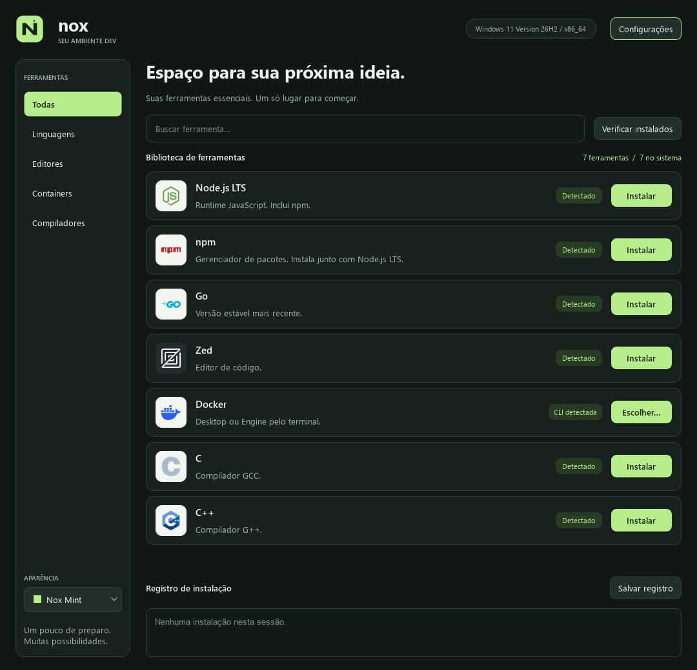

# Nox

A desktop app to install the tools I use for programming, without looking up each installation command.

Built with C++ and Qt 6 for Linux and Windows.

[Project website](https://uevertonpassos.github.io/Nox/)



## Download

- [Windows x64 — .exe installer](https://github.com/uevertonpassos/Nox/releases/latest/download/Nox-Windows-x64.exe)
- [Linux x86_64 — AppImage](https://github.com/uevertonpassos/Nox/releases/latest/download/Nox-Linux-x86_64.AppImage)
- [Linux x86_64 — .tar.gz package](https://github.com/uevertonpassos/Nox/releases/latest/download/Nox-Linux-x86_64.tar.gz)

[All releases](https://github.com/uevertonpassos/Nox/releases)

On Windows, open the installer. Nox uses WinGet to install the tools.

On Linux, make the AppImage executable and open it:

```bash
chmod +x Nox-Linux-x86_64.AppImage
./Nox-Linux-x86_64.AppImage
```

If you get a FUSE error, use:

```bash
./Nox-Linux-x86_64.AppImage --appimage-extract-and-run
```

The AppImage is built on Ubuntu 22.04 and requires glibc 2.35 or newer. The `.tar.gz` package uses your system's Qt 6 libraries: extract it and run `bash install.sh`.

## Tools

- Node.js LTS
- npm, bundled with Node.js LTS
- Go stable
- Zed
- Docker Desktop or Docker Engine
- C and C++ compilers

Go and npm have no separate LTS channel. For npm, Nox uses the version bundled with Node.js LTS.

On Linux, installation commands are available for Debian/Ubuntu, Fedora, Arch/CachyOS, and openSUSE. Windows uses Docker Desktop. On Arch/CachyOS, use Docker Engine.

## Usage

Search for a tool, click **Install**, and review the commands before confirming. The output appears at the bottom of the window.

The app starts in English. Open **Settings → Language** to choose **English** or **Português**. The change takes effect immediately and is saved for the next session.

Use the sidebar to browse languages, editors, containers, and compilers. Search also filters within the selected category; press **Ctrl+K** to focus it.

Choose **Nox Mint**, **Ocean**, **Violet**, **Ember**, or **Daylight** in the sidebar to change the theme immediately. Your choice is saved. **Settings → Theme** also offers a live preview: **Save** keeps it and **Cancel** restores the previous theme. Changing themes or languages preserves the current search and installation output.

“Detected” means the executable was found. It does not confirm its version or, for Docker, whether the service is running.

A few details:

- An internet connection is needed to download tools.
- On Linux, open Nox without `sudo`. The system asks for your password when needed.
- Node.js and Go are installed in `~/.local/share/nox`. Open a new terminal after installation.
- On Arch/CachyOS, installing system packages also updates the system with `pacman -Syu`.
- Docker Desktop requires virtualization: KVM on Linux, or WSL 2 or Hyper-V on Windows.
- NixOS, Alpine, and package installation on immutable systems are not supported yet.
- The Windows installer is not digitally signed.

## Build

Requires C++17, CMake 3.22+, Ninja, and Qt 6.2+ with Widgets, Network, Svg, and Test.

On Arch/CachyOS:

```bash
sudo pacman -Syu --needed base-devel cmake ninja qt6-base qt6-svg qt6-wayland
```

On Ubuntu/Debian:

```bash
sudo apt install build-essential cmake ninja-build qt6-base-dev libqt6svg6-dev qt6-wayland
```

Then:

```bash
git clone https://github.com/uevertonpassos/Nox.git
cd Nox
cmake -S . -B build -G Ninja -DCMAKE_BUILD_TYPE=Release
cmake --build build
./build/nox
```

On Windows, use Qt 6 for MSVC 2022 and CMake. The installer build is in [.github/workflows/build.yml](.github/workflows/build.yml).

## Files

- `src/main.cpp`: starts the app.
- `src/window.cpp`: window, buttons, search, and settings.
- `src/system.cpp`: detects the system and selects installation commands.
- `src/installer.cpp`: fetches version information and runs installations.
- `src/language.cpp`: loads translations and saves the language preference.
- `resources/translations/pt_BR.json`: Portuguese translations.
- `resources/toolchain.sh`: installs Node.js and Go on Linux.
- `resources/style.qss`: window appearance.
- `src/theme.cpp`: five color palettes and saved theme preference.
- `resources/nox.svg`: editable logo; [desktop icon generation](resources/BRANDING.md).
- `docs/`: static project website, including real screenshots of all five themes.

## Tests

```bash
ctest --test-dir build --output-on-failure
```

Tests check installation commands, search, language settings, and a simulated installation in a temporary folder. They do not install tools on the host system.

They also check category filters, theme persistence, settings preview/cancellation, and rendering in every theme. To regenerate the actual program screenshots used on the website (Qt Widgets, no mockups):

```bash
QT_QPA_PLATFORM=offscreen NOX_SCREENSHOT_DIR="$PWD/build/screenshots" ./build/window_test themesRender
python -m pip install pillow
python scripts/prepare-screenshots.py build/screenshots
```

Screenshots use Portuguese and the actual executable detection results of the capture machine. The script converts the captures to lossless WebP; it does not alter the interface or statuses.

On Windows, set `QT_QPA_FONTDIR=C:/Windows/Fonts` when using Qt's offscreen platform so the captures can load system fonts.

## Project website

The site at **https://uevertonpassos.github.io/Nox/** is served from `docs/` by `.github/workflows/pages.yml`. Changes to that folder on `main` deploy automatically through GitHub Pages. It uses plain HTML, CSS, and JavaScript, with no build step, external fonts, or runtime dependencies.

For a local preview, run `python -m http.server 8088 --directory docs` and visit `http://localhost:8088`.

## Releases

GitHub Actions builds Linux and Windows packages. A tag such as `v0.1.0` publishes the files to Releases after the build and tests pass.

## Credits

[Logo sources](resources/logos/SOURCES.md). Qt libraries and licenses are listed in [THIRD_PARTY.md](THIRD_PARTY.md).
